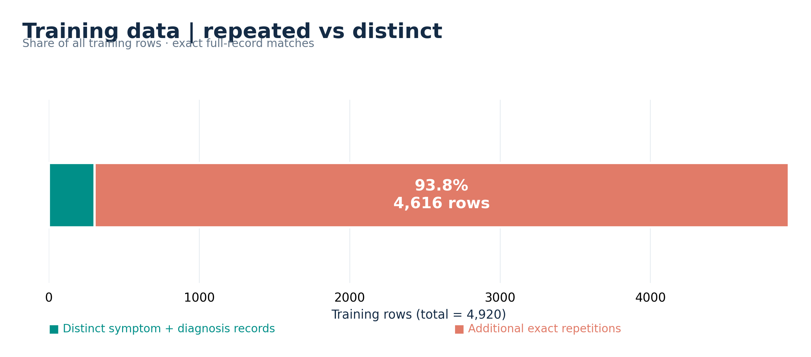
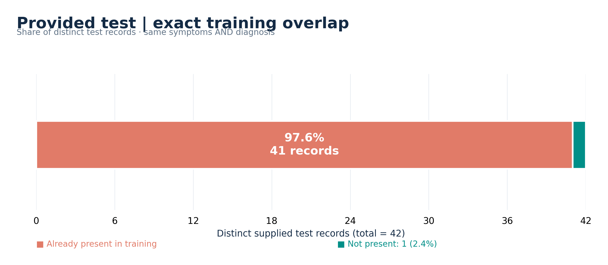
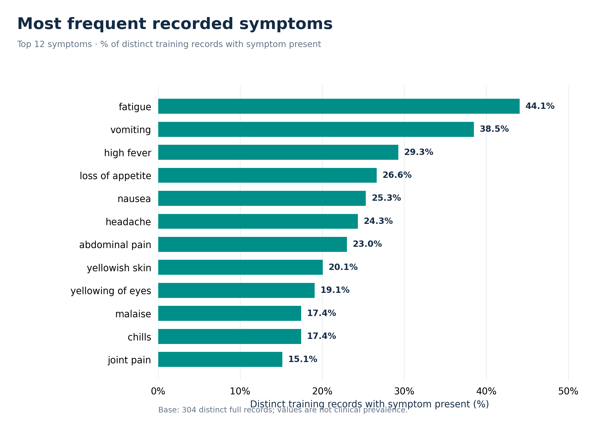
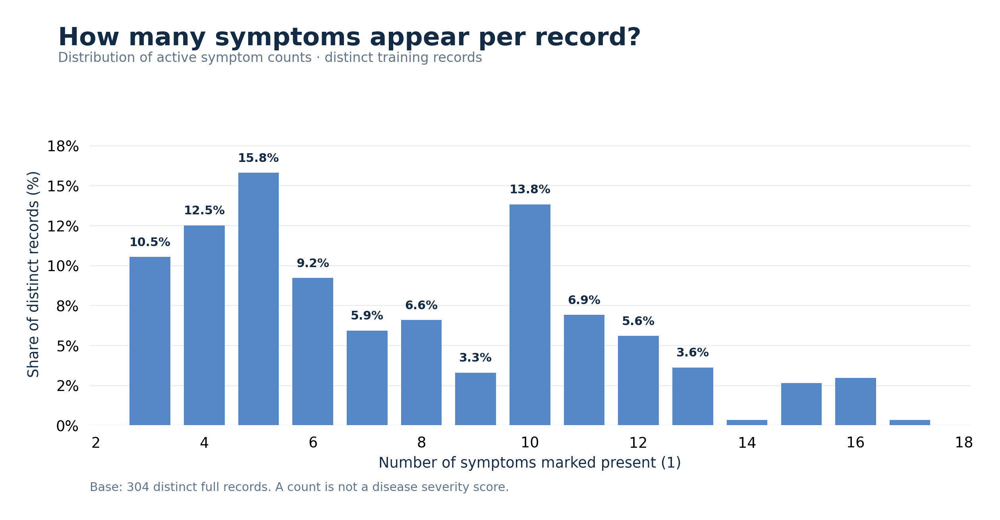
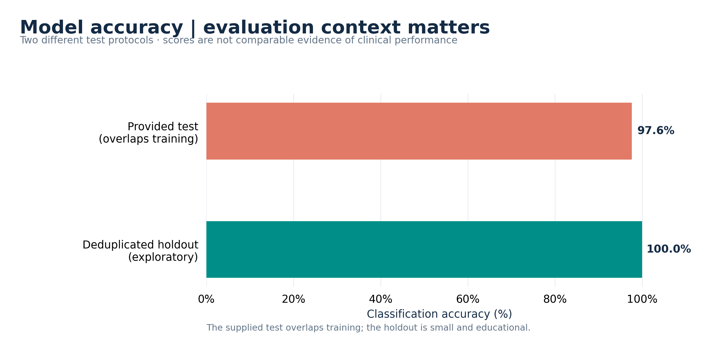

# Healthcare Data Quality & Visualization

**Python | Pandas | Data Cleaning | Data Visualization | Machine Learning**

## 📌 Project Overview

This project focuses on data quality assessment, exploratory data analysis (EDA), and professional visualization of a healthcare-related dataset.

The dataset contains:
- **4,920** training records
- **42** testing records
- **132** symptom features
- **41** diagnostic categories

## 🔍 Key Findings

- **93.8%** of training records are exact duplicates of earlier records.
- **97.6%** of testing records overlap with training data.
- High model accuracy can be misleading when training and testing data overlap.

## 📊 Data Visualizations

### 1. Training Data Quality

Percentage of unique and repeated records.

### 2. Train–Test Overlap

Detection of overlapping records between training and testing datasets.

### 3. Most Frequent Symptoms

Top 12 symptoms by percentage of distinct training records.

### 4. Symptom Distribution

Distribution of symptom counts per distinct record.

### 5. Machine Learning Evaluation

Comparison of model accuracy across evaluation approaches.

## 🛠️ Tools & Skills

- **Python & Pandas:** Data cleaning and preprocessing
- **Matplotlib & Seaborn:** Data visualization
- **Scikit-learn:** Exploratory machine learning
- **Data Quality:** Duplicate detection and validation
- **Reporting:** Clear communication of analytical findings

## 🚀 How to Run

1. Open the notebook in Google Colab.
2. Upload `Training.csv` and `Testing.csv`.
3. Run all cells.
4. Download the charts as PNG, PDF, or ZIP.

## ⚠️ Limitations

This project uses an educational healthcare dataset. Results do not establish clinical diagnostic reliability or real-world disease prevalence.

---

**Project Focus:** Data Cleaning | Data Quality | EDA | Data Visualization
