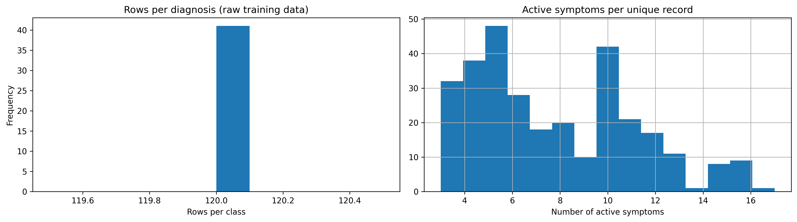
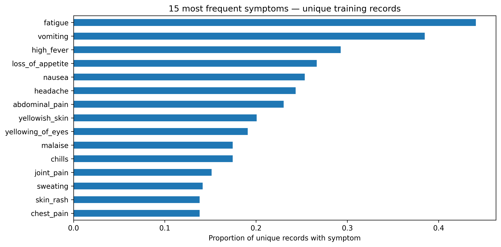

# Healthcare Data Quality & Machine Learning

## Project Overview

This project explores data quality and machine
learning methodologies using a healthcare dataset
containing symptom-based diagnostic categories.

The analysis focuses on identifying data quality
issues, assessing potential data leakage, and
evaluating the reliability of predictive results.

## Project Objectives

- Explore the structure and quality of healthcare data
- Identify duplicate observations
- Assess potential data leakage
- Apply data preprocessing techniques
- Train and evaluate a machine learning model
- Compare validation strategies
- Interpret results and methodological limitations

## Tools & Technologies

- Python
- Pandas
- NumPy
- Scikit-learn
- Matplotlib
- Seaborn
- Google Colab

## Methodology

The project includes exploratory data analysis,
duplicate detection, data preprocessing, and
machine learning model evaluation.

A stratified train-test split was applied after
deduplication to reduce exact record overlap
between training and testing datasets.

## Key Findings

The analysis highlights how duplicated observations
and dataset characteristics can influence machine
learning performance.

High predictive accuracy does not necessarily
indicate strong generalization to unseen patients,
particularly when training and testing records overlap.

## Limitations

- Limited number of unique observations per diagnosis
- Potential biases in the original dataset
- Limited clinical information
- No independent external validation
- No demonstrated clinical utility

## Skills Demonstrated

- Healthcare Data Analysis
- Data Quality Assessment
- Duplicate Detection
- Data Preprocessing
- Machine Learning Fundamentals
- Model Evaluation
- Data Leakage Assessment
- Scientific Interpretation

## Dataset Source

**Dataset:** Disease Prediction Using Machine Learning

**Dataset creator:** Kaushil Mangaroliya (Kaushil268)

**Platform:** Kaggle

**Source:** [View Original Dataset](https://www.kaggle.com/datasets/kaushil268/disease-prediction-using-machine-learning)

The dataset contains binary symptom indicators and corresponding diagnostic categories.

It was used in this project to investigate data quality, duplicate observations, potential data leakage, and machine learning evaluation.

The original dataset is credited to its creator. Dataset provenance and licensing conditions
should be reviewed before redistribution or commercial use.

This analysis is intended for educational and portfolio purposes only.

## Disclaimer

This project is intended for educational and
research purposes only.

The model is not validated for clinical diagnosis
or medical decision-making.

## Data Visualizations

### Diagnosis and Symptom Distributions

Exploratory analysis of the number of records per
diagnostic category and the distribution of active
symptoms across unique training records.

### Most Frequent Symptoms

Visualization of the 15 most frequently reported
symptoms across unique training records.

